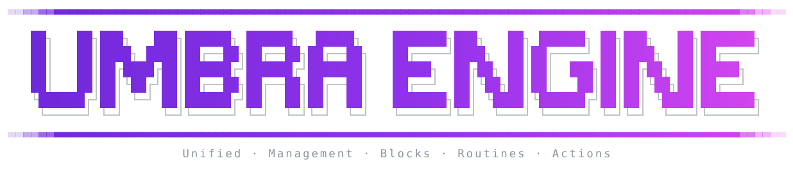

<div align="center">



**Orquestador de agentes de IA 100% de terminal:**
**de la spec a la PR, con evidencia y aprobación humana.**

[](CHANGELOG.md)
[](https://github.com/alejoc0314/umbra-engine/actions/workflows/ci.yml)
[](pyproject.toml)
[](LICENSE)

</div>

---

umbra convierte una idea o una especificación en tareas y las lleva por un ciclo completo de
trabajo con agentes intercambiables (Claude Code y Codex integrados; cualquier ejecutable con
un manifiesto). Cada tarea corre en su propio worktree, deja evidencia verificable y **nada se
integra sin tu aprobación**.

```text
 spec ─▶ tareas ─▶ PLAN ─▶ DESIGN ─▶ BUILD ─▶ REVIEW ─▶ VERIFY ─▶ SCAN ─▶ SHIP ─▶ tú apruebas
                                       ▲                  │
                                       └──────────────────┘  hallazgos: vuelve a BUILD (máx. 2 ciclos)
```

## Empezar en un minuto

```bash
uv tool install git+https://github.com/alejoc0314/umbra-engine
umbra doctor && umbra init          # comprueba git, gh, claude y codex; configura el repo
umbra spec new "mi idea"            # conversación guiada: spec → plan → tareas
umbra run 1 && umbra watch          # el agente trabaja en segundo plano; tú miras el panel
umbra approve 1                     # revisas evidencia y diff, y se integra
```

Necesitas `git`, `gh` y al menos un agente (`claude` o `codex`) con sesión iniciada. umbra no
guarda credenciales: usa tus logins.

## Qué hace hoy

### 🧭 De la idea a las tareas
- **`umbra spec new`**: conversación con puntos de control donde apruebas la spec, el plan y
  las tareas antes de seguir. Se retoma con `spec resume`.
- **`umbra plan spec.md`**: el proponente sugiere tareas en borrador desde una spec existente.
- Tareas con criterios verificables, dependencias (`task deps`) y revisión antes de aceptarlas.

### ⚙️ Un ciclo completo con evidencia
- Rutinas `feature` (PLAN → DESIGN → BUILD → REVIEW → VERIFY → SCAN → SHIP) y `quick`
  (BUILD → SHIP), configurables en `.umbra/routines/`.
- **BUILD** corre tus tests; si fallan, el agente recibe la salida y reintenta.
- **REVIEW** con Codex en solo lectura, con Claude de respaldo si falla.
- **VERIFY** comprueba cada criterio y, si registras `dev`, abre la app en el navegador
  (Playwright) y deja una captura por criterio.
- **SCAN** bloquea secretos y corre tu SAST. **SHIP** publica la rama y abre el PR.
- **Escalada y árbitro**: si el constructor se atasca entra un perfil más fuerte; si constructor
  y revisor no se ponen de acuerdo, un árbitro decide.

### 👀 Control total desde la terminal
- **`umbra watch`**: panel en vivo ordenado por atención, con progreso por etapa, costo,
  línea de tiempo narrada, evidencia, diff y lo que hace el agente en este momento. Todo se
  maneja con teclas o con la paleta (`Ctrl+P`). Trae temas.
- **`umbra explain N`**: qué pasó, por qué y qué puedes hacer, con los comandos.
- **Arréglalo tú**: `umbra open N` abre la tarea en tu editor y `umbra done N` sigue el ciclo
  con tu commit.
- **Varias a la vez**: `[blocks] parallel`, ramas de spec que se integran solas y **una sola
  aprobación por spec**. **Modo noche** (`umbra night`): deja todo encolado y avanzando.

### 🎨 Diseñar antes de construir
- Un diseñador propone pantallas en HTML/CSS (o en tu herramienta vía MCP) y un **crítico** las
  revisa con una rúbrica de UX antes de preguntarte.
- Direcciones para elegir, sistemas de diseño del equipo y tu **gusto** (`~/.umbra/gusto.md`),
  que se aprende en cada decisión.
- **`umbra design replicar`**: captura el diseño actual de una app que ya existe, vista por
  vista.

### 🔍 Llegar a un proyecto que ya existe
- **`umbra onboard`**: reconocimiento, línea base de tests, cinco exploradores en paralelo y
  hasta 8 preguntas. Redacta `CONTEXT.md`, la **constitución** del proyecto y el inventario de
  capacidades para que los apruebes.
- **`umbra new`**: crea un proyecto desde un playbook (`python`, `node`, `laravel` o los de tu
  equipo) con repo, CI, convenciones y primera spec.

### 🗂️ Muchos repos, una sola cola
- `umbra projects` y `umbra watch --all` para todos tus repos.
- **Espacios de trabajo**: front y back en repos separados con una cola, un `watch` y una
  aprobación. Las **tareas entre repos** las hace un solo agente que ve los dos lados.

### 📱 Decidir desde el teléfono
- Bot de **Telegram** con botones para aprobar, rechazar o responder al agente, informes con
  capturas y toda la consola de `watch` en comandos (`/tareas`, `/evidencia`, `/integrar`…).
- Conversación en lenguaje natural sobre tus proyectos; también abre specs y proyectos nuevos.

### 🧠 Lo que umbra aprende
- **`.umbra/aprendido.md`**: tus decisiones sobre hallazgos y respuestas; un revisor no vuelve
  a frenar por algo que ya decidiste.
- **`CONTEXT.md`**: mapa del repo que escribe el cartógrafo y se actualiza tras cada integración.
- **`umbra metrics`**: tiempo hasta PR y merge, costo, ciclos de corrección y aceptación inicial.

### 🔌 Extensible
- Agentes intercambiables (`umbra agent add`), perfiles por rol (`umbra profile new`) con sus
  propios servidores MCP, y **paquetes** (`umbra pack sync`) para lo privado de tu equipo.
- **`umbra chat`**: conversa con Claude sobre el proyecto (opcional: todo existe como comando).
- **MySQL local**: `umbra db query` consulta libre en solo lectura; `umbra db change` propone y
  nada se aplica sin tu permiso.
- **`umbra self-update`**: instala la última versión publicada.

### 🛡️ Seguro por defecto
- Los tests existentes están protegidos: se pueden añadir, no borrar, desactivar ni debilitar.
- Rutas protegidas, filtro de secretos, SAST y aislamiento opcional en Docker sin red.
- Los agentes no heredan tus plugins ni ganchos globales, y umbra no carga la configuración de
  agente del repo sin tu permiso.
- `approve` exige terminal interactiva y que el SHA aprobado sea exactamente el evaluado.

## Documentación

| | |
| --- | --- |
| 📘 [Guía de uso](docs/usage.md) | Todos los comandos, `watch`, Telegram, diseño, espacios de trabajo |
| 🔌 [Integrar agentes](docs/adapters.md) | Cualquier ejecutable como agente con un manifiesto |
| 🏗️ [Diseño](docs/design.md) | Arquitectura y decisiones |
| 📜 [Constitución](.specify/memory/constitution.md) | Los principios del proyecto |
| 🗒️ [CHANGELOG](CHANGELOG.md) · [Specs](specs/) | Qué trae cada versión y cómo se especificó |

## Desarrollo

```bash
uv sync
uv run pytest        # sin red ni costo: agentes y gh falsos, remoto git local
uv run ruff check .
```

## Contribuir y licencia

Lee [`CONTRIBUTING.md`](CONTRIBUTING.md) antes de abrir un PR y [`SECURITY.md`](SECURITY.md) para
reportar vulnerabilidades. umbra se publica bajo la [licencia Apache 2.0](LICENSE).
